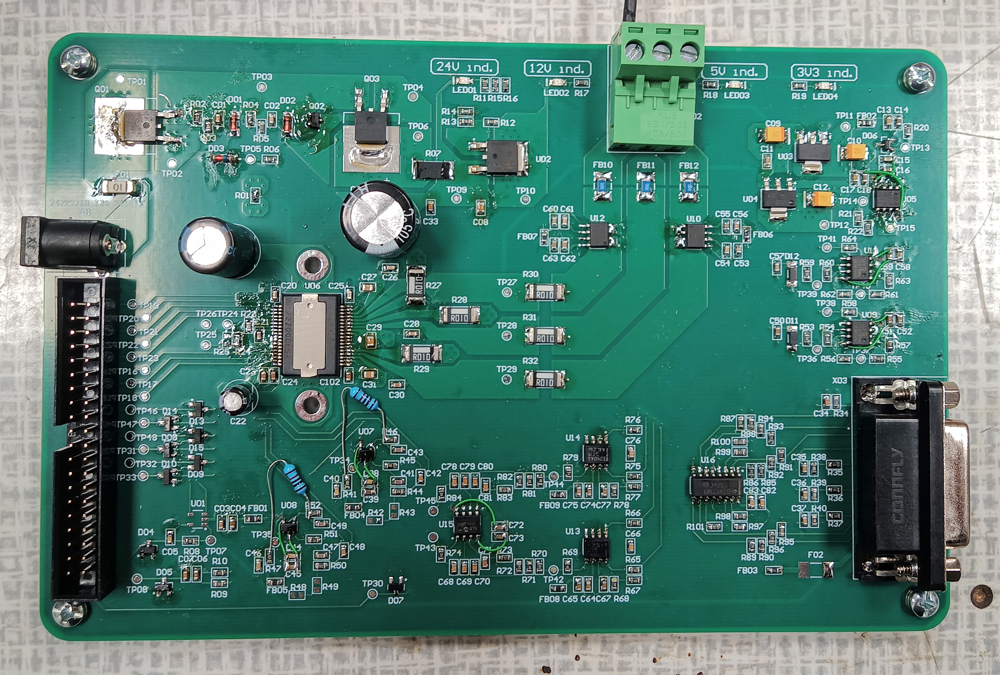
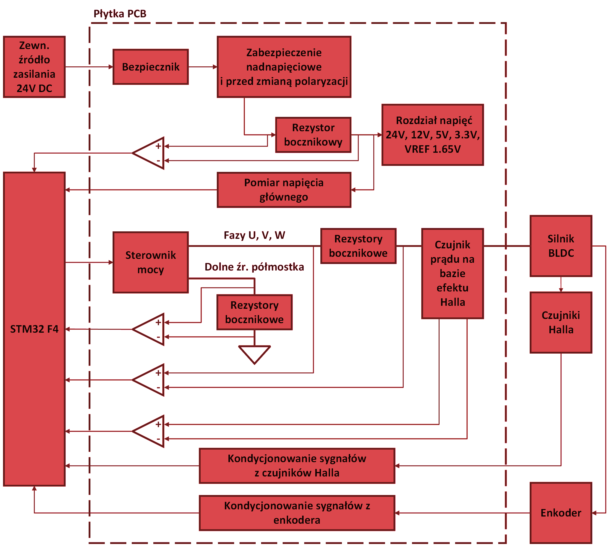
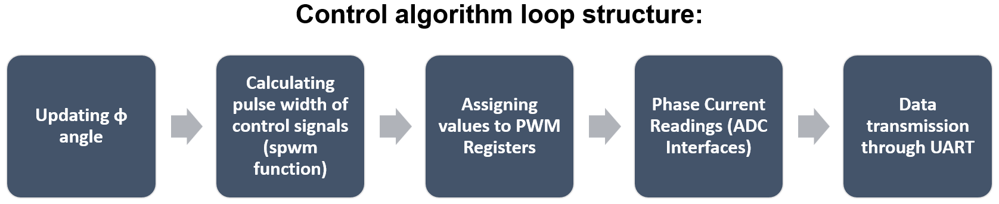
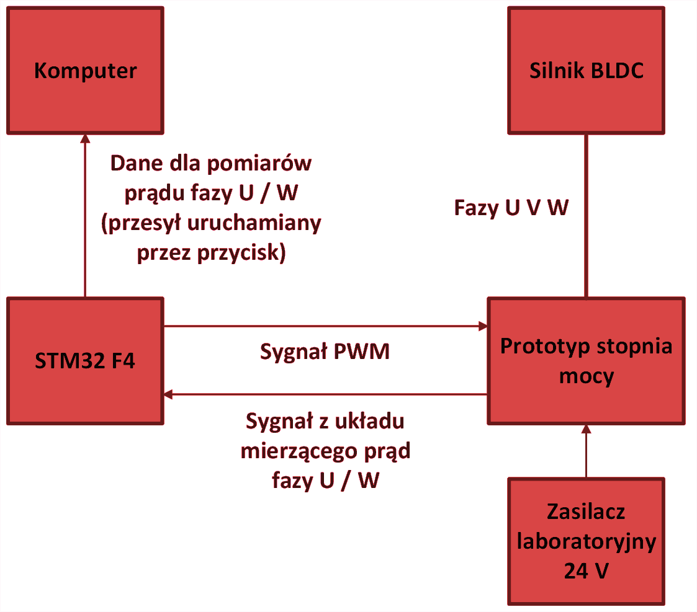
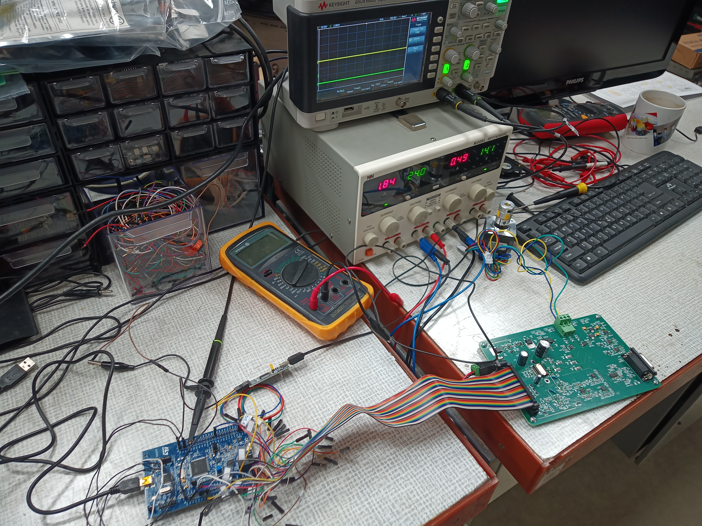
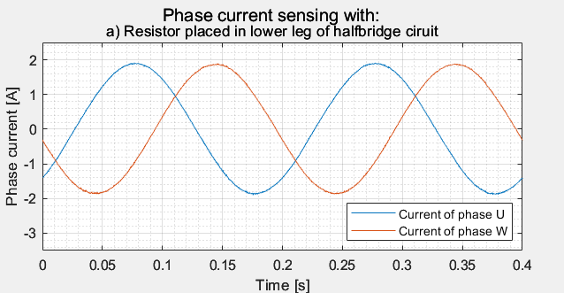
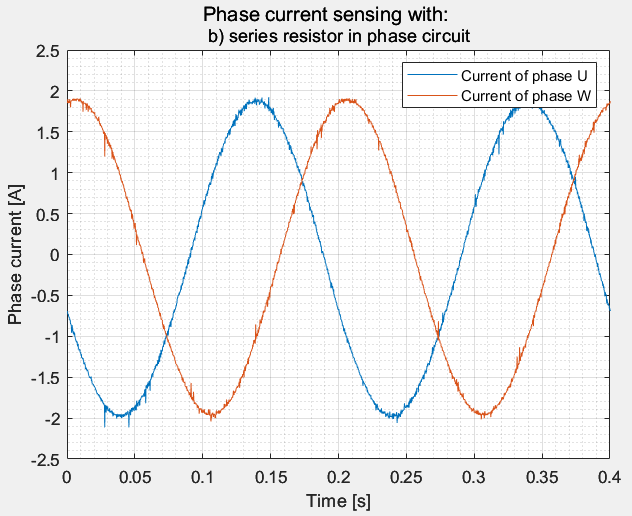
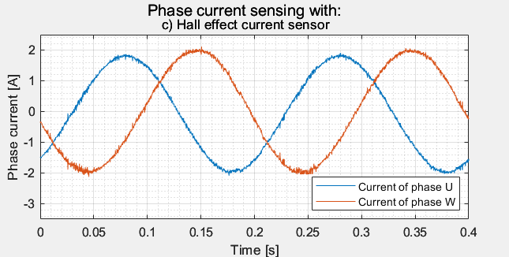
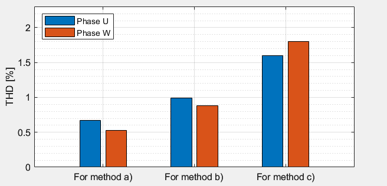

# 3-phase-motor-current-measurement-eval-board

  

Power stage evaluation board designed for comparison of three different phase current measurement methods in terms of quality.

## Project Objective
The objective was a hardware and software comparison of three phase current measurement methods regarding high-frequency interference, impact on current waveforms, and potential applications in PMSM and BLDC motor control.

## Hardware Architecture

  

The project features a custom-designed Printed Circuit Board (PCB) acting as a power stage. Key system parameters include:
* Microcontroller: STM32F4.
* Motor Driver: DRV8332.
* Main Power Supply: 24V DC.
* Additional Interfaces: Signal conditioning for Hall effect sensors and an encoder.

## Implemented Measurement Methods
The board allows for the verification of three different topological concepts:
1) Series resistor in the motor phase circuit: Measures the voltage drop using a differential amplifier. This method achieved the highest measurement accuracy (THD below 0.5%) but generates significant power losses and lacks galvanic isolation.
2) Resistor in the source circuit of the half-bridge low-side transistor: Measures the voltage drop using an operational amplifier. A budget-friendly solution with moderate distortion (THD between 0.8% and 1%), dedicated to measuring low-value currents.
3) Hall effect-based current sensor: Provides galvanic isolation and allows measurement of the actual phase current with minimal added resistance. In tests, it generated the highest THD values (1.5% - 2%) at low currents due to EMI susceptibility.

## Software and Control

  

The control algorithm was implemented in C using the STM32CubeIDE environment and HAL libraries. The main loop executes:
* SPWM signal generation (duty cycle calculation).
* Phase current readouts via ADC interfaces.
* Measurement data transmission via UART interface to a PC application.

Markdown
## Test Bench and Measurement Results

The physical verification of the evaluation board was conducted on a dedicated test bench.

  

  

### Phase Current Waveforms Quality
The primary goal of the test bench was to acquire and compare the signal quality from the three different sensing topologies. The captured phase current waveforms (Phase U and Phase W) demonstrate varying levels of high-frequency noise:

* **Method a) Resistor placed in lower leg of half-bridge circuit:** Provided the smoothest sinusoidal waveforms with minimal noise.

  

* **Method b) Series resistor in phase circuit:** Exhibited moderate high-frequency interference superimposed on the main sine wave.

  

* **Method c) Hall effect current sensor:** Resulted in the highest level of signal distortion and noise spikes.

  

### THD (Total Harmonic Distortion) Analysis

  

The visual observation of the waveforms is directly confirmed by the THD analysis. The measured THD values for Phase U and Phase W clearly indicate the performance differences between the topologies:
* **Method a) Resistor placed in lower leg of half-bridge circuit:** Lowest distortion, ranging between ~0.5% and ~0.7%.
* **Method b) Series resistor in phase circuit:** Moderate distortion, measuring ~0.9% to ~1.0%.
* **Method c) Hall effect current sensor:** Highest distortion, peaking between ~1.6% and ~1.8%.
